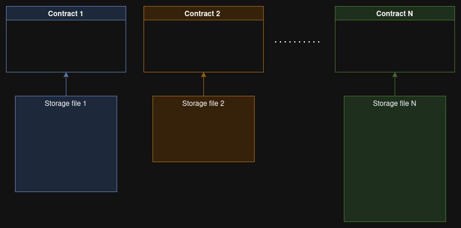
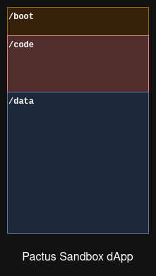

## Abstract

This proposal specifies how decentralized applications (called **Applications**, or **dApps**) are
stored and executed on Pactus.
Each Application owns a single renewable **storage file** that holds its execution code and its data,
and an address of its own under which it holds PAC.
An Application runs in a sandbox. Its computation is free of charge: a call pays a flat charge and a
charge for the bytes of the file that it reads and writes and for the memory that it uses, and
nothing for the instructions that it executes.
What stops a call is a **count of steps** that every node makes alike, not a price and not a clock,
so all nodes agree on the result of every call.
A call applies whole or not at all, and the signer of a call never pays more than the amounts that
it signed.

This PIP does not depend on Native Assets ([PIP-56](./pip-56.md)). When both are active, an
Application can also hold, receive, send and issue assets, without any change to the records or
the payloads of PIP-56 (see [Working with PIP-56](#working-with-pip-56)).

## Motivation

Ethereum-friendly blockchains keep contract data in a global key/value database, where
each item is addressed by a key derived from the contract's address. That model is a flat,
schemaless slot-to-value map, with no structure or metadata,
and without a simple way to delete a contract's data as a unit.
Pactus instead dedicates _one file per Application_, containing both code and data, which can be
renewed or deleted as a unit (see [Storage file](#storage-file)).

Two properties follow, and they decide what Applications are good at:

- **Computation is not priced.** There is no gas table. An Application whose logic is heavy and whose
  state is small, such as a turn-based game, costs its users the same flat charge as a trivial one.
- **Storage is rented, and it ends.** An Application that has done its work, such as an escrow or a
  bet, closes itself or simply expires, and its file leaves the nodes.

An Application is useful only if it can hold value. This PIP therefore says how an Application
holds, receives and sends PAC, and how it does the same with the assets of PIP-56 when they exist.

An Application can also call another Application, inside one transaction and under the same bounds
(see [Calls between Applications](#calls-between-applications)).

## Specification

The key words "MUST", "MUST NOT", "SHOULD" and "MAY" are to be interpreted as described in RFC 2119.

Integers are little-endian and fixed width unless a field is marked _varint_. `Hash` is BLAKE2b-256,
the hash Pactus already uses, and `||` is byte concatenation. `h` is the height of the block that
carries a transaction. An **account address** is an address of type BLS account (`2`), Ed25519
account (`3`) or secp256k1 account (`4`), and no other, unless a later PIP adds a type with a key to
this list. The treasury address, a validator address and the address of an Application are never
account addresses. `PAC(a)` is the PAC balance of the address `a`, in nano PAC.

### Terminology

- **Application (dApp)**: code plus data, stored in one storage file, with its own address.
- **Owner**: the account that controls an Application. It deploys and changes the code, and it can
  transfer the ownership to another account or give it up.
- **Storage file**: the on-chain file assigned to an Application. It has a fixed capacity and a
  limited lifetime.
- **Call**: a transaction that enters an Application by `execute`, and all the code that it runs.
- **Step**: the unit in which the work of a call is counted. Steps bound a call. They are never
  paid for.
- **Charge**: PAC that a payload or a call pays to the treasury besides the ordinary fee:
  `CreationCharge`, `CodeCharge`, rent, and the charge of a call.
- **Engine**: the software that a node uses to run the code. It is not part of this specification.

### Parameters

The values below are initial proposals. They are constants of the protocol version, and a later
version may change them ([PIP-51](./pip-51.md)). A value marked _measured_ is set by the benchmark of
the [Reference Implementation](#reference-implementation); where the table gives one, it is a
first proposal.

| Name                    | Value                | Meaning                                                    |
| ----------------------- | -------------------- | ---------------------------------------------------------- |
| `ChunkSize`             | 4 096 bytes          | Unit of capacity, of metering and of the file commitment   |
| `MinCapacity`           | 16 chunks            | Smallest file                                              |
| `MaxCapacity`           | 4 096 chunks         | Largest file (16 MiB). _Measured_                          |
| `RentPeriod`            | 8 640 blocks         | Unit of rent, one day on mainnet                           |
| `MaxRentHorizon`        | 365 periods          | Furthest that `ExpiresAt` may lie ahead                    |
| `GracePeriod`           | 30 periods           | Time after expiry during which a file can still be renewed |
| `RentPrice`             | _to be set_          | PAC per chunk per period                                   |
| `CreationCharge`        | 0.2 PAC              | Paid once by `AppCreate` for records that are never removed |
| `CodeCharge`            | 0.1 PAC              | Paid by every `AppSetCode`                                 |
| `MaxCodeSize`           | _measured_           | Largest execution code                                     |
| `MaxMemoryPages`        | 64                   | Largest memory of a call, in pages of 64 KiB (4 MiB). _Measured_ |
| `MaxInputSize`          | 4 096 bytes          | Largest input of a call                                    |
| `MaxOutputSize`         | 1 024 bytes          | Largest output of a call                                   |
| `MaxCallSteps`          | _measured_           | Most steps of one call                                     |
| `MaxReadChunks`         | _measured_           | Most distinct chunks that one call reads                   |
| `MaxDirtyChunks`        | _measured_           | Most distinct chunks that one call writes                  |
| `MaxPACOutputs`         | 8                    | Most `pac_send` of one call                                |
| `MaxCallDepth`          | 4                    | Most Applications that run at one moment in a call         |
| `MaxInnerCalls`         | 8                    | Most `app_call` of one call. _Measured_                    |
| `InnerCallCharge`       | _to be set_          | Charge per `app_call`                                      |
| `CallCharge`            | _to be set_          | Flat part of the charge of a call                          |
| `ChunkReadCharge`       | _to be set_          | Charge per distinct chunk read                             |
| `ChunkWriteCharge`      | _to be set_          | Charge per distinct chunk written                          |
| `PageCharge`            | _to be set_          | Charge per page of memory at the peak                      |
| `SweepReward`           | 0.1 PAC              | Paid to the account that sweeps a deleted Application      |
| `MaxAppCallsPerBlock`   | _measured_           | Most `AppCall` and `AppAssetCall` in one block             |
| `MaxAppCodePerBlock`    | 2                    | Most `AppSetCode` in one block                             |
| `MaxAppCreatesPerBlock` | _measured_           | Most `AppCreate` and `AppExtend` in one block              |
| `MaxAppBytesPerBlock`   | _measured_           | Most bytes of the payloads that a block caps by count      |

### Application address

Each Application has its own address, separate from the address of its owner:

```text
address = Type || Hash160(Hash256(ID of the AppCreate transaction))
```

- `Hash160` and `Hash256` are the hashes that Pactus already uses to derive account addresses.
- Every transaction ID is unique, so the address is unique with no new state, and it is known as
  soon as the `AppCreate` transaction is built.
- An address MUST NOT be reused. A deleted Application keeps its address, and a new `AppCreate`
  always creates a new one, so an address always refers to the same Application.
- `Type` is a new address type, `6`, so wallets and explorers can tell an Application from an account
  by its address alone and warn that it has no private key. With bech32m it reads as `pc1x...`.

The address of an Application has no key. It never signs a transaction or any other message, and no
rule lets it act without a transaction that an account address signed. It is invalid as the sender
or a receiver of every existing payload, a plain `Transfer` or `BatchTransfer` included: PAC reaches
an Application only by a host function that its own code calls. An implementation MUST NOT widen its test of
an account address to accept type `6`.

### State

#### Application record

Every Application has one record. Records are kept in a new Merkle tree, `appMerkle`, in the order
of their creation. A record is never removed and never moves: when an Application is deleted, its
record stays, with the last values that it had.

| Field        | Type      | Notes                                                               |
| ------------ | --------- | ------------------------------------------------------------------- |
| `Address`    | 21 bytes  | The address of the Application                                      |
| `Flags`      | `uint8`   | Bit 0: `HasOwner`. Bit 1: `Finished`. Other bits MUST be 0          |
| `Owner`      | 21 bytes  | An account address. Present only if `HasOwner` is set               |
| `CreatedAt`  | `uint32`  | Height of the block that created the Application                    |
| `ExpiresAt`  | `uint32`  | Last height at which the Application is live                        |
| `Capacity`   | `uint32`  | Size of the file, in chunks                                         |
| `CodeChunks` | `uint32`  | Chunks reserved for `/boot` and `/code`. Fixed at creation          |
| `CodeHash`   | 32 bytes  | `Hash` of the execution code. All zero while no code is deployed    |
| `CodeSeq`    | `uint32`  | Number of `AppSetCode` executed so far                              |
| `FileRoot`   | 32 bytes  | Commitment to the file (see [Storage file](#storage-file))          |
| `Holdings`   | `uint32`  | Number of asset holdings of the Application. 0 without PIP-56       |

An Application whose ownership was given up has `HasOwner` cleared and no `Owner` field. No address
stands for "no owner": in particular 21 zero bytes, which is the treasury address, is never written
or read as an owner.

The tree has the shape of the trees of the node, and its leaves and inner nodes are hashed in
separate domains, a leaf committing to its index `i` (a `uint32`):

```text
leaf(i)    = Hash(0x00 || i || Bytes(record i))
node(l, r) = Hash(0x01 || l || r)
```

`appRoot` is the root of this tree, and 32 zero bytes while the tree is empty. A node keeps a local
index from an address to its record. The index is not consensus state: a node MUST be able to
rebuild it from the tree, and MUST stop, not continue, when it disagrees with the tree.

#### State root

For a block below the version `V` that activates this PIP, the state root is unchanged. For a block
of version `V` or higher:

```text
stateRoot = HashMerkleBranches(R, appRoot)
```

`R` is the state root as the other rules of that block version define it, without this PIP. The
same rule therefore holds whether PIP-56 is active or not, and whichever of the two activates
first. Application state MUST be persisted in the same store batch as accounts and validators.

#### PAC

The PAC of an Application is the balance of an ordinary account record in the account tree, under
the address of the Application. `AppCreate` creates it with a balance of 0. Supply audits therefore
count it as they count any account, and no total is kept elsewhere.

### Storage file

Each Application is defined in an isolated file that contains both code and data. Its capacity is
rented before deployment.



The file is divided into three parts:

| Part  | Contents                             |
| ----- | ------------------------------------ |
| /boot | Fixed-size layout of the file        |
| /code | The bytecode to run                  |
| /data | Application Data part                |

`/boot` and `/code` take the first `CodeChunks` chunks of the file, and `/data` takes the rest.
Neither boundary ever moves: a change of code never moves the data, and an extension adds chunks at
the end of `/data`.

#### Boot

The `/boot` section is a fixed-size 128-byte, versioned, little-endian structure at the start of the
file:

| Field         | Size (Bytes) | Description                                      |
| ------------- | ------------ | ------------------------------------------------ |
| `version`     | 2            | File format version. `1` in this PIP             |
| `engine`      | 1            | Kind of code. `1` is WASM                        |
| `flags`       | 1            | Reserved, 0                                      |
| `code_offset` | 4            | Offset of the execution code. `128`              |
| `code_size`   | 4            | Length of the execution code, 0 before deployment |
| `data_offset` | 4            | Offset of the data section, `CodeChunks × ChunkSize` |
| `reserved`    | 112          | Reserved for future fields, 0                    |

`/boot` describes the layout of the file and nothing else. What must outlive the file, the owner and
the lifetime in particular, is in the [Application record](#application-record).
Changing the layout of existing fields requires a new `version`, and nodes MUST reject versions
they do not understand.

#### Execution code

The `/code` section contains the bytecode for the declared `engine`, followed by zero bytes up to
the start of `/data`. For WASM this is a module that is valid by the rules of
[Module validity](#module-validity). Only `AppSetCode` writes it.

#### Data

The data section is a flat range of bytes that the code reads and writes through the host. It is all
zero when the file is created. How an Application arranges it is its own business: an allocator, if
it wants one, is a library inside its code, not a structure that consensus knows about.
The owner MAY extend the file by renting more chunks; existing offsets MUST NOT change.

#### File commitment

The file is split into its `Capacity` chunks of `ChunkSize` bytes. `FileRoot` is the root of a
Merkle tree of the same shape as the tree of records, with chunk `i` as leaf `i`. A leaf does not
commit to its index: the record holds `Capacity`, and equal chunks, the zero chunks of a new file
above all, then share their hashes, so that creating a file costs a few hashes and not one per
chunk:

```text
leaf(i)    = Hash(0x00 || chunk i)
node(l, r) = Hash(0x01 || l || r)
```

`FileRoot` changes whenever a byte of the file changes. No host function exposes it to the code, so
nothing a call does depends on it.

### Payloads

Seven payload types are added here, and two more in [Working with PIP-56](#working-with-pip-56).
They take the next free payload type numbers, which the editors assign. Rules common to all of them:

- `Signer()` is `From`, and `From` is an account address.
- The transaction is signed, expires and is protected against replay like every other transaction,
  and it pays the fee of a `Transfer`.
- `Check` reads the state and changes nothing. A transaction that fails `Check` is **invalid**: it
  cannot be in a block. An implementation MUST apply the same tests wherever it executes a block,
  on the path that commits and syncs blocks included.
- Every PAC amount is in `0 .. MaxNanoPAC`, and every sum and every product MUST be checked before
  it is formed ([PIP-54](./pip-54.md)).
- `Check` includes that `PAC(From)` is at least the fee plus every amount that the payload takes
  from `From`.
- Every charge, rent included, is credited to the treasury. It is not a fee: it MUST NOT be part
  of the fees of the block that the subsidy transaction pays to the proposer.
- Decoding MUST consume exactly the declared fields, and a varint MUST use its shortest encoding.

`Rent(c, p) = RentPrice × c × p` is the rent of `c` chunks for `p` periods.

#### `AppCreate`

| Field        | Type     | Notes                                           |
| ------------ | -------- | ----------------------------------------------- |
| `From`       | Address  | The purchaser, who becomes the owner            |
| `Capacity`   | `uint32` | `MinCapacity <= Capacity <= MaxCapacity`, in chunks |
| `CodeChunks` | `uint32` | `1 <= CodeChunks < Capacity`                    |
| `Periods`    | `uint16` | `1 <= Periods <= MaxRentHorizon`                |

It takes `CreationCharge + Rent(Capacity, Periods)` from `From`, to the treasury. It appends a
record with `HasOwner` set, `Owner = From`, `CreatedAt = h`,
`ExpiresAt = h + Periods × RentPeriod`, no code, `CodeSeq = 0` and `Holdings = 0`; it creates the
file, all zero but for `/boot`; and it creates the account record of the Application at 0 PAC.

#### `AppSetCode`

| Field  | Type          | Notes                                              |
| ------ | ------------- | -------------------------------------------------- |
| `From` | Address       | MUST be the owner                                  |
| `App`  | Address       |                                                    |
| `Code` | length, bytes | At most `MaxCodeSize`, and it MUST fit in `/code`  |

`Check`: the Application is live and has an owner, who is `From`; `Code` is a valid module. It takes
`CodeCharge` from `From`. It writes the code, sets the rest of `/code` to zero, sets `code_size`
and `CodeHash = Hash(Code)`, and adds 1 to `CodeSeq`. `/data` and the PAC of the Application are
untouched. The new code runs from the next call on.

#### `AppRenew`

| Field     | Type     | Notes                |
| --------- | -------- | -------------------- |
| `From`    | Address  | Any account address  |
| `App`     | Address  |                      |
| `Periods` | `uint16` | At least 1           |

`Check`: the Application is live or in grace. With `E' = ExpiresAt + Periods × RentPeriod`:
`E' >= h`, and `E' - h <= MaxRentHorizon × RentPeriod`. It takes `Rent(Capacity, Periods)` from
`From` and sets `ExpiresAt = E'`. The renewal counts from the old expiry, so the time that an
Application spent in grace is paid for.

#### `AppExtend`

| Field         | Type     | Notes                                       |
| ------------- | -------- | ------------------------------------------- |
| `From`        | Address  | MUST be the owner                           |
| `App`         | Address  |                                             |
| `NewCapacity` | `uint32` | `Capacity < NewCapacity <= MaxCapacity`     |

`Check`: the Application is live and has an owner, who is `From`. It takes the rent of the added
chunks for the periods that are left, `Rent(NewCapacity - Capacity, p)`, where
`p = max(1, ceil((ExpiresAt - h) / RentPeriod))`. It sets `Capacity = NewCapacity`; the new chunks
are zero and are added at the end of `/data`. Only the owner extends, because a larger file costs more to renew.

#### `AppSetOwner`

| Field      | Type    | Notes                                              |
| ---------- | ------- | -------------------------------------------------- |
| `From`     | Address | MUST be the owner                                  |
| `App`      | Address |                                                    |
| `HasOwner` | `uint8` | `1` to transfer the ownership, `0` to give it up. Any other value is invalid |
| `NewOwner` | Address | An account address. Present only if `HasOwner` is `1` |

`Check`: the Application is live and has an owner, who is `From`. It sets `HasOwner` and `Owner` as
given. The address of the Application does not change.

#### `AppCall`

| Field       | Type          | Notes                                               |
| ----------- | ------------- | --------------------------------------------------- |
| `From`      | Address       | The caller                                          |
| `App`       | Address       |                                                     |
| `CodeHash`  | 32 bytes      | The code that the caller agrees to run              |
| `CodeSeq`   | `uint32`      | The `CodeSeq` that the caller saw                   |
| `MaxPAC`    | _varint_      | Most PAC that the code may take from `From`         |
| `MaxCharge` | _varint_      | Most charge that the call may cost. At least `CallCharge` |
| `Input`     | length, bytes | At most `MaxInputSize`. Opaque to consensus         |

`Check`: the Application is live; it has code; `CodeHash` and `CodeSeq` equal those of the record;
`PAC(From) >= fee + MaxPAC + MaxCharge`. The code then runs as [Execution](#execution) describes.
`CodeHash` and `CodeSeq` protect the caller against a change of code between the moment it signs
and the moment the call is included: `CodeSeq` also covers a code that was changed and changed back.

#### `AppSweep`

| Field  | Type    | Notes               |
| ------ | ------- | ------------------- |
| `From` | Address | Any account address |
| `App`  | Address |                     |

`Check`: the Application is deleted, its `Holdings` is 0, and its PAC is above 0. With `b` the PAC
of the Application, it pays `min(b, SweepReward)` to `From`, so that someone has a reason to sweep,
and the rest to the treasury, and leaves the Application at 0 PAC. The owner gains no more by
letting an Application die than any other account that sweeps.

### Execution

#### What this PIP fixes, and what it leaves to a node

This PIP fixes what every node must compute alike: which code is valid, what a call does to the
state, when a call stops, and what it costs. It does not say how a node runs the code. A node MAY
interpret it or compile it, cache what it compiles, and store the file as it sees fit, as long as
the result is the one that this PIP defines.

**The clock of a node never decides the validity of a block, the vote of a validator on it, or its
effect.** A node MAY use a time limit of its own to decide which calls it puts in a block that it
proposes, and for nothing else.

#### Module validity

Whether a `Code` is valid is defined by this PIP and its test vectors, never by an engine: two
engines, or two versions of one engine, MUST agree on every module. The rule is an allowlist.
Anything that it does not name is invalid. A valid module:

- uses integer types and integer instructions only. No floating-point type or instruction, no
  vector instruction, no thread, no reference type beyond what indirect calls need;
- imports nothing but the host functions of this PIP, those of
  [Working with PIP-56](#working-with-pip-56) included: a module that imports them is valid whether
  or not PIP-56 is active;
- exports a function `execute`, MAY export a function `on_call`, both with no parameter and no
  result, exports nothing else, and has no start function;
- has exactly one memory, with a declared maximum of at most `MaxMemoryPages`;
- stays within numeric limits on its size, its functions, their locals and bodies, their nesting,
  and its table;
- is encoded canonically, with no section that this PIP does not name.

The exact list of instructions and sections and the numeric limits are fixed with the reference
implementation ([Open items](#open-items-of-this-draft)). They are a function of the block version:
a later version MAY allow more, and says what becomes of code deployed under earlier rules.

#### A call

A call runs `execute` once, in a new instance of the module, whose memory is zero except for what
the data segments of the module place in it. The code sees
its input, the state of its own file, and what the host functions give it. It has no access to
time, to randomness, to the network or to the filesystem of the node, and it reaches another
Application only by `app_call` ([Calls between Applications](#calls-between-applications)).

#### The counted bound

Every call has a count of **steps**, which is a function of the transaction, the state and the
height, and of nothing else:

- entering an Application counts steps in proportion to its initial memory and, the first time
  that it runs in the transaction, to the length of its code;
- every instruction that is executed counts at least one step;
- an instruction or a host function that works on a range of bytes counts steps in proportion to
  its length, and a host function that touches a chunk of the file counts steps per chunk;
- growing the memory counts steps per page.

A call whose count would pass `MaxCallSteps` **aborts**, at a point that is the same on every node.
The depth of calls inside the code is bounded by a count as well, made on the code and not on the
stack of the machine. The memory of a call is at most `MaxMemoryPages`, counted over all the
instances that exist at one moment. A growth beyond the declared maximum of the module returns -1,
as WebAssembly defines it: it counts no page and adds nothing to the charge, and the instruction
counts its steps like any other. Any other growth, and any initial memory, that would bring the
pages of all instances above `MaxMemoryPages` aborts the call. Every other growth succeeds: a node
that cannot provide it has a fault and stops, and the call does not see it.

Steps have no price. The exact way of counting is fixed with the reference implementation and its
vectors, and is a function of the block version ([Open items](#open-items-of-this-draft)).

#### Host functions

A valid module imports only these. Pointers and lengths refer to the memory of the call, and a
range outside it aborts the call.

| Function        | Effect                                                                    |
| --------------- | ------------------------------------------------------------------------- |
| `input_size`    | Length of `Input`                                                         |
| `input_read`    | Copies a range of `Input` into memory                                     |
| `output_write`  | Sets the output of the call, at most `MaxOutputSize` bytes                |
| `height`        | `h`                                                                       |
| `caller`        | Writes the caller: `From` in `execute`, the calling Application in `on_call` |
| `self_address`  | Writes the address of the Application                                     |
| `data_size`     | Length of `/data`                                                         |
| `data_read`     | Copies a range of `/data` into memory                                     |
| `data_write`    | Copies a range of memory into `/data`                                     |
| `pac_balance`   | PAC of the Application                                                    |
| `pac_take`      | Takes PAC from the caller (below)                                         |
| `pac_send`      | Sends PAC to an account (below)                                           |
| `app_finish`    | Closes the Application for good (see [Lifecycle](#lifecycle))             |
| `app_call`      | Calls another Application ([below](#calls-between-applications))          |
| `pac_return`    | In `on_call` only: gives PAC back to the calling Application              |

A range outside `/data`, a function called outside its rules, or an argument outside its domain
aborts the call. The output of `execute` is not part of the state: a node returns it when it
simulates a call, and nothing else reads it. The output of `on_call` is given to the calling code.

The functions that move PAC are specified like payloads. In code that runs as `execute`:

- `pac_take(n)`: `1 <= n`, and the sum of all the amounts taken by `execute`, `n` included, is at
  most `MaxPAC`. The sum only grows: a later `pac_send` to the caller does not lower it. It moves
  `n` from `From` to the Application.
- `pac_send(to, n)`: `to` is an account address; `1 <= n <= PAC(App)`; the call has made fewer than
  `MaxPACOutputs` sends. It moves `n` from the Application to `to`, creating the account of `to` if
  it does not exist, as a `Transfer` does.

No balance ever passes `MaxNanoPAC`: a move that would is an abort.

### Outcome of a call

A call that passed `Check` has one of two outcomes, and both are valid entries of a block.

- **Success.** `execute` returns, or calls `app_finish`. Everything the call did is applied
  together: the bytes written to the file, the PAC taken and sent, the accounts created, and the
  fields of the record.
- **Abort.** The code traps; or the count of steps, the depth of calls inside the code, the memory, `MaxReadChunks` or
  `MaxDirtyChunks` is exceeded; or a host function is called outside its rules, a refused `app_call`
  included; or the charge would pass `MaxCharge`. Nothing the call did is applied: not a byte of
  the file, not a unit of PAC, not a new account.

Accounts, holdings and asset records that a call creates take their places in the order in which
the host functions run, and an aborted call uses none. In both cases the signer pays the fee of the
transaction, before the code runs, and the charge of the call, when it ends, and the transaction ID
is recorded as executed. The outcome is not written in the block: a node learns it
by executing the call, and SHOULD offer it, and the simulation of a call, through its RPC.

#### Charge

```text
charge = CallCharge
       + ChunkReadCharge  × (distinct chunks of /data read)
       + ChunkWriteCharge × (distinct chunks of /data written)
       + PageCharge       × (pages of memory at the peak)
       + InnerCallCharge  × (number of app_call)
```

Chunks are counted by Application and index, over every file that the call touches. A chunk counts
as read at the first `data_read` that covers one of its bytes, and as written at the first
`data_write` that covers one of its bytes, even if the bytes do not change; a write is not a read,
and the chunks of `/code` are not counted. The pages are those of the memory of the instances, in
units of 64 KiB, the initial size included, and not what the machine maps.

The charge grows as the call runs: `CallCharge` when the call starts, the charge of a chunk at its
first read or write, the charge of a page when the pages reach a new peak, and `InnerCallCharge`
when `app_call` is called, before its rules are tested, so that a call that is refused still pays
for the search of the Application that it names. An operation that would pass `MaxCallSteps`,
`MaxMemoryPages`, `MaxReadChunks`, `MaxDirtyChunks` or `MaxCharge` adds nothing, and the call
aborts there. Every other host function tests its rules before it adds to the charge. A call that
succeeds pays its charge. A call that aborts pays the charge reached at the abort: the operation
that would pass a bound has added nothing, and a refused `app_call` has added its
`InnerCallCharge`.

Whatever the code does, the signer of a call pays at most `fee + MaxPAC + MaxCharge`.

### Lifecycle

The state of an Application at height `h` follows from its record and from constants, on every
node alike, with no action at any block:

| State    | Condition                                           | Valid payloads                          |
| -------- | --------------------------------------------------- | --------------------------------------- |
| Live     | `h <= ExpiresAt`, not `Finished`                    | All but the sweeps                      |
| Grace    | `ExpiresAt < h <= ExpiresAt + GracePeriod × RentPeriod`, not `Finished` | `AppRenew` only     |
| Deleted  | `h > ExpiresAt + GracePeriod × RentPeriod`, not `Finished` | The sweeps only                  |
| Finished | `Finished` is set                                   | None                                    |

Any account MAY renew, so the users of an Application can keep it alive without its owner. In
grace no call runs and nothing changes but a renewal, which makes the Application live again:
nodes keep the file, and funds cannot be withdrawn. After the grace period the Application is
deleted for good: nodes MAY drop the bytes of the file, and the record stays.



#### Finishing

`app_finish(to)` is a host function. No payload closes an Application: only its code does, so an
Application without an owner can still close. Rules: `to` is an account address, and the
Application has no holding. If it has PAC, it sends all of it to `to`, as a `pac_send` that counts
in `MaxPACOutputs`; if it has none, nothing is sent, no account is created and no send is counted. It
sets `Finished` and ends the code of the Application with success: no instruction of the
Application runs after it, and nodes MAY drop its file. Rent that was paid and not used is
not returned, so an Application that expects a short life rents a short period.

### Ownership

The owner is recorded in the Application record. It MUST be an account address; a multisig
account, if another PIP defines one as an account address with a key, MAY be an owner. Once the
ownership is given up, the code can no longer change, the file can no longer be extended and no
account can take the ownership, but any account can still renew the file.

**While an Application has an owner, the owner can change its code at once, and the new code can
take everything the Application holds.** Only an Application whose ownership was given up has code
that its users can rely on. A wallet MUST show which of the two an Application is before the user
signs a call, and, when it can tell, whether the Applications that it calls have an owner. It MUST
show `MaxPAC` and `MaxCharge` as the amounts at risk.

### Block capacity

An **Application transaction** is a transaction whose payload type is one of this PIP. A block of a
version below `V` carries none. A block of version `V` or higher carries at most:

- `MaxAppCallsPerBlock` `AppCall` and `AppAssetCall`, counted together, so that one number bounds
  the code that a block runs;
- `MaxAppCodePerBlock` `AppSetCode`;
- `MaxAppCreatesPerBlock` `AppCreate` and `AppExtend`, counted together;
- `MaxAppBytesPerBlock` bytes of the payloads counted above, as the block encodes them.

`AppRenew`, `AppSetOwner` and `AppSweep` run no code and count in none of these caps, so a full
lane of calls cannot keep an Application from being renewed.

The counts read only the version of the block, the payload type and the length of the payload of
each entry, so a validator makes them before it verifies any signature. These numbers bound the
work that Applications add to a block only because every Application transaction keeps three
rules: what it does to the state depends only on the transaction, on the state before it, on the
height and the version of its block and on constants of the network; it applies whole or not at
all, the fee and the charge of an aborted call excepted; and its work is bounded by constants that
every node counts alike, never by elapsed time.

The caps are constants of each protocol version, set by the benchmark of the worst block that the
rules of that version allow ([Reference Implementation](#reference-implementation)).

### Calls between Applications

The code of an Application can call another Application, inside the transaction that an account
signed. No payload changes: a transaction enters one Application by `execute`, and every other one
is entered by `app_call` from code. Each entry is a **frame**: a new instance, initialised as in
[A call](#a-call), which sees its own file as the transaction has left it so far. A frame and its
instance end when its function returns or calls `app_finish`; its pages then stop counting.

**Entry.** `execute` runs only as the entry of a transaction, and its caller is the account that
signed. `on_call` runs only when another Application calls. An Application whose module does not
export `on_call` is never entered by another one.

**The call.** `app_call(app, code_hash, max_pac, max_pac_back, assets, input)` runs `on_call` of
`app` to its end, gives its output to the calling code and continues it. The transaction aborts
unless:

- `app` is live, has code that exports `on_call`, and its `CodeHash` is
  `code_hash`. The pin is mandatory: there is no call to unknown code;
- `app` has no frame that is running. No Application is entered twice at one time, directly or
  through others, and none calls itself;
- fewer than `MaxCallDepth` frames are running, and the transaction has made fewer than
  `MaxInnerCalls` calls;
- `max_pac` and `max_pac_back` are in `0 .. MaxNanoPAC`, and `input` has at most `MaxInputSize`
  bytes;
- `assets` is empty. Only [Working with PIP-56](#working-with-pip-56) gives it entries.

**Inside `on_call`.** `caller` is the calling Application. No host function gives the signer of the
transaction: the authority of a call is its direct caller. `input_size`, `input_read` and
`output_write` are those of this call. `pac_take(n)` takes from the calling Application, never from
the signer: `1 <= n`, `n` is at most the PAC of the calling Application, and the sum taken in this
frame is at most `max_pac`. `pac_return(n)` exists only here: `1 <= n <= PAC(App)`, and the sum
returned in this frame is at most `max_pac_back`; it moves `n` to the calling Application.
`pac_send` still pays accounts only. An Application that calls `app_finish` in `on_call` is
finished: its frame ends with success, and a later `app_call` to it in the transaction aborts.

**Outcome.** The transaction has one outcome. A trap, a broken rule or a passed bound in any frame
aborts it, and nothing that it did is applied, in any Application. No code catches the abort of the
code that it called. Called code that wants to refuse returns, with an output that says so.

**Bounds and charge.** `MaxCallSteps`, the depth of calls inside the code, `MaxReadChunks`,
`MaxDirtyChunks`, `MaxMemoryPages`, `MaxPACOutputs`, the charge and `MaxCharge` bound all that one
transaction runs, in all its frames, and a node MUST keep these counts for the transaction. An
`app_call` counts steps for its input and its output. The signer pays the whole charge, within
`MaxCharge`. The caps of a block count transactions: their
benchmark uses calls that make `MaxInnerCalls` calls to Applications of `MaxCodeSize`, with nothing
cached.

**Rules that bind later PIPs.**

1. The bounds and the outcome belong to the transaction. Only `on_call` is entered by an
   Application, only `execute` by a transaction, and no Application is entered while it runs.
2. The PAC and the units of an Application rise only by a host function that its own code calls,
   a take being within the maximum that the party it takes from stated, or by a return from code
   that it called, within a maximum that its own code stated in that call. Nothing else is ever
   sent to an Application.
3. Code runs only inside a transaction that an account address signed. Code lowers the balance of
   an account only in a transaction that the account signed, by a take of the `App` of the
   payload, within the maxima of that payload.
4. The bits of `Flags` that this PIP does not name, the reserved bytes of `/boot`, every other
   export name and every host function name that this PIP does not list (among them `signer`,
   `app_info`, `app_renew`, hashing and the verification of signatures) are reserved. A record, a
   file or a module that uses them is invalid.

### Working with PIP-56

This section applies only in a block of a version in which both this PIP and
[PIP-56](./pip-56.md) are active. Until then its payloads are invalid and its host functions abort.
It changes no record and no payload of PIP-56. An Application is a _program_ in the sense of
section 6, rule 7 of PIP-56: its address has no key, it is never an account address there, and it
holds units in ordinary holdings that only the rules below place, credit, debit and remove.

#### `AppAssetCall`

An `AppAssetCall` is an `AppCall` with one more field, and the same rules:

| Field    | Type                | Notes                                                |
| -------- | ------------------- | ---------------------------------------------------- |
| `Assets` | 0 to 4 entries      | `AssetID` in strictly ascending order                |
| `Assets[].AssetID`   | `uint32` | An asset that exists                                |
| `Assets[].MaxAmount` | _varint_ | Most units that the code may take from `From`. `0 .. MaxAssetSupply` |
| `Assets[].MaxRate`   | `uint16` | Largest sum of the two current rates that the caller accepts. At most 10 000 |

It is an asset transaction of PIP-56 (sections 4.1 and 6, rule 1). It counts as `AssetCallWeight`
asset transactions in `MaxAssetTxPerBlock`, and the weights of the `AppAssetCall` of a block add up
to at most `MaxAppAssetShare`; both are constants set by the benchmark, and `MaxAppAssetShare` is
at most half of `MaxAssetTxPerBlock`, so that calls cannot crowd out plain asset transfers. An
`AppAssetCall` also counts in `MaxAppBytesPerBlock` and in `MaxAppCallsPerBlock`.

The asset host functions exist in every frame of an `AppAssetCall`; in an `AppCall` they abort.
They act only on an asset that the payload lists, or that the call itself created. A call makes at
most 8 of them, `asset_balance` not counted, and at most 1 `asset_create`, in all its frames. A
holding is placed and removed exactly as `AssetAccept` and `AssetClose` of PIP-56 do it, and a call
that finds no room in the asset tree aborts.

| Function        | Rules and effect                                                          |
| --------------- | ------------------------------------------------------------------------- |
| `asset_balance(id)` | Units that the Application holds, and whether it has a holding         |
| `asset_accept(id)`  | The Application has no holding of the asset and at least `HoldingDeposit` in PAC. Places its holding at balance 0, locks the deposit from its own PAC, adds 1 to `Holdings` |
| `asset_take(id, n)` | `1 <= n`, and the sum taken in this frame for this asset is at most the `MaxAmount` of the payload, or, in `on_call`, the take maximum of that asset in the `assets` of the `app_call`. The caller holds at least `n`, and the Application holds the asset. Returns the net amount |
| `asset_send(id, to, n, max_rate)` | `to` is an account address that holds the asset; `1 <= n <=` the balance of the Application. Returns the net amount |
| `asset_burn(id, n)` | `1 <= n <=` the balance of the Application. With no rate. Adds `n` to `Burned`, or, if the Application is the `Issuer` of the asset, subtracts `n` from `Issued` |
| `asset_close(id, max_burn)` | The balance is at most `max_burn`. Burns it as `asset_burn` does, frees the holding, returns its deposit to the PAC of the Application, subtracts 1 from `Holdings` |
| `asset_create(...)` | Takes the fields of `AssetCreate` of PIP-56 but `From` and the policy, with the same checks. Creates the asset with no policy and the Application as `Issuer`. It pays `AssetCharge`, and with an initial supply `HoldingDeposit` as well, from the PAC of the Application, and aborts if that PAC is below the sum. With an initial supply it places the holding of the Application as `asset_accept` does. Returns the `AssetID` |
| `asset_mint(id, n)` | The Application is the `Issuer` and holds the asset; `1 <= n <= MaxSupply - Issued`. Adds `n` to `Issued` and to its holding |
| `asset_return(id, n)` | In `on_call` only. `1 <= n <=` the balance of the Application, and the sum returned in this frame is at most the return maximum of that asset in the `assets` of the `app_call`. The calling Application holds the asset. Returns the net amount |

`asset_take`, `asset_send` and `asset_return` move units from one holding to another, so they pay
the split of section 3.3 of PIP-56, at the current rates of the asset: `n` is the gross amount, the
receiver gets the net amount, and a net amount of 0 aborts the call. `Check` does not test the
rates: the function that moves the units does, and aborts the call unless the sum of the two
current rates is at most the `MaxRate` of the payload, which an asset created in the call always
meets since it has no policy; for `asset_send`, at most `max_rate` as well; and for an `asset_take`
or an `asset_return` in `on_call`, at most the rate of that asset in the `assets` of the `app_call`
as well. The code supplies `max_rate` because the units that it sends are often those of a user
who is not the caller: the code can keep the bound that this user accepted, and no caller can then
force a transfer at a higher rate.

**Consent.** The program itself consents to a holding: only its own code places one, with
`asset_accept` or `asset_create`, and pays the deposit from its own PAC. A caller may give it the
PAC for the deposit, but neither the signature nor the payment of a caller, or of the owner, places
a holding.

**Between Applications.** In an `AppAssetCall`, the `assets` of an `app_call` has 0 to 4 entries,
in strictly ascending order of `AssetID`: an asset that the payload lists or that the call created,
the most units that the called code may take, the most that it may return, and the largest sum of
the two rates that the calling code accepts. The maxima are in `0 .. MaxAssetSupply` and the rate
is at most 10 000. In `on_call`, `asset_take` takes from the calling Application within the take
maximum, and `asset_return` gives back to it within the return maximum. `asset_send` pays accounts
only.

**Issuing.** An asset whose `Issuer` is an Application is created with no policy. Its `Issued`
rises only by `asset_mint`, within the `MaxSupply` fixed at creation, and falls only when the
Application that issued it burns units of its own holding; its `Burned` never decreases. An
Application that issues units and burns those that come back, as a stablecoin does, therefore
keeps its room. Units that anyone else burns are added to `Burned` and free no room. Section 6,
rule 6 of PIP-56 leaves this choice to the PIP that creates the asset, and the bounds and the
conservation of units of its section 2.3 hold. No `AssetMint` or `AssetSetRate` ever passes for
such an asset. Whoever controls the code controls the mint: while the Application has an owner,
that is the owner. A wallet MUST show it to the holders of such an asset, not only to the callers
of the Application.

**The invariants of PIP-56.** The holdings of an Application are ordinary holdings, and every
invariant of section 2.3 of PIP-56 counts them. In particular the balance of an account falls only
in a transaction that the account signed, and by at most the `MaxAmount` that the payload states;
`Input` states none.

**Later rules on holdings.** A rule that a later PIP adds to the holdings of PIP-56, a freeze for
example, applies to the holding of an Application as to any other. A host function that such a
rule forbids aborts the call.

#### Stablecoins

This subsection adds no rule. Nothing above keeps a stablecoin from existing, whether an account
issues it against a reserve off the chain, an Application issues it against collateral that it
holds, or accounts that attest a deposit on another chain call an Application that mints. A price,
or any fact from outside the chain, enters as the input of a call, and code that runs as `execute`
knows from `caller` which account signed it. An issuer that mints and burns for as long as it lives
chooses a `MaxSupply` with room for the units that others burn. An Application that issues a
stablecoin has to outlive its units: see [Security Considerations](#security-considerations).

#### `AppAssetSweep`

| Field      | Type           | Notes                                    |
| ---------- | -------------- | ---------------------------------------- |
| `From`     | Address        | Any account address                      |
| `App`      | Address        | A deleted Application                    |
| `AssetIDs` | 1 to 8 entries | In strictly ascending order              |

It is an asset transaction, of weight 1. `Check`: the Application is deleted and holds each asset of the list.
For each asset, in the order of the list: the units of the holding are added to `Burned`, the
holding is freed, its deposit is paid to `From`, and `Holdings` falls by 1. Once `Holdings` is 0,
`AppSweep` clears the PAC. The list is part of the payload so that every node frees the same
holdings in the same order.

A deleted or finished Application is _stopped for good_ in the sense of PIP-56: it consents to
nothing more. An Application cannot finish while it has a holding, so only deleted Applications
are swept.

## Rationale

**A count, not a clock.** An earlier draft bounded a call by a time that each node set for itself.
Two honest validators with different machines could then disagree on one block. A count that every
node makes alike gives the same guard with no disagreement and, like the timeout, it needs no
cost table, because a step has no price.

**Free computation, paid storage.** What a call leaves behind is bytes, and what it borrows is
memory, so that is what it pays for. Computation leaves nothing behind, and the caps of a block
already bound it.

**A charge to the treasury.** The fee of a transaction goes to the proposer of its block, so
it costs a proposer nothing to fill its own blocks with its own calls. A charge that goes to the
treasury costs a proposer what it costs anyone.

**The code takes; the caller sets the limit.** A caller does not know in advance exactly what a call
will need, and an Application must be able to refuse a payment. So the payload states a maximum, the
code takes what it needs within it, and what it does not take never moves.

**An aborted call is included and pays.** If it were left out of the block, proposers and validators
would run it for nothing, which is the cheapest way to exhaust them.

**Only renewal during grace.** A second way of running the code, in which funds may leave and not
enter, is hard to define for an Application that redeems shares, and it doubles what must be
tested. An Application that wants its users to be able to leave lets them leave while it is live,
or finishes.

**No engine in the specification.** A node can start with the simplest engine and move to a faster one without a
change of protocol. This PIP therefore promises computation that is free and bounded, and makes no
claim about its speed.

**Calls between Applications, with few ways to go wrong.** Most losses of funds in programs that
call each other come from code that is entered when it did not expect it, that receives what it did
not ask for, or that takes the signer for its caller. Here an Application is entered only if its
code asks for it and never while it runs, it is credited only within a maximum that its own code
stated, and called code never learns who signed. A call names the code that it expects, and one
failure undoes the whole transaction, so there is no result that a caller can forget to check.

## Backwards Compatibility

This PIP adds a new kind of state (Application records and storage files), a new address type
(`6`), new payload types, and one more level in the state root. Nodes that do not know address
type `6` reject it, so the change takes effect only after the upgrade. It also needs something the
node does not have today: a transaction that is included in a block and whose effects are
discarded. It requires a protocol upgrade as described in [PIP-51](./pip-51.md).

## Test Cases

Implementations MUST pass at least these. They add no rule to the Specification.

- **Agreement.** Two engines, and one engine on two kinds of processor, give the same outcome, the
  same charge and the same roots for every vector, including calls that abort on the last step.
- **Validity.** A module with a floating-point instruction, a start function, an import that is not
  a host function, an export other than `execute` and `on_call`, two memories, or a section that
  is not named is rejected, by every engine. A record with a bit of `Flags` that is not named is
  invalid.
- **Abort.** A call that traps, runs out of steps, reads one chunk too many or passes `MaxCharge`
  is included, changes no byte of the file and no balance but those of the fee and the charge, and
  creates no account. The same call is invalid, not aborted, when `CodeSeq` does not match.
- **PAC.** `pac_take` beyond `MaxPAC` aborts, in one take or in several; a take, a send back and a
  second take count twice. `pac_send` to the treasury, a validator or an Application aborts. An
  amount of 0 or below aborts. A `Transfer` to an Application is invalid.
- **Lifecycle.** At `ExpiresAt` a call is valid; at `ExpiresAt + 1` it is invalid and a renewal is
  valid; one block after the grace period a renewal is invalid and a sweep is valid if the
  Application holds PAC. A renewal and
  a call in one block succeed in that order only.
- **Finish.** `app_finish` sends all the PAC, and a later transaction to the Application in the
  same block is invalid. It aborts while `Holdings` is above 0.
- **Ownership.** After the ownership is given up, `AppSetCode`, `AppExtend` and `AppSetOwner` are
  invalid and `AppRenew` is valid. No record holds 21 zero bytes as an owner.
- **Root.** The state root is the wrapped root from the first block of version `V`, with
  `appRoot` at 32 zero bytes, with and without PIP-56 active.
- **Calls.** A call to an Application that calls back the first, or itself, aborts. So does a call
  with another `code_hash`, to an Application without `on_call`, in grace or finished, a ninth
  `app_call`, a `pac_take` beyond `max_pac` and a `pac_return` beyond `max_pac_back`. An abort in
  the second Application that is called leaves the file of the first unchanged. In `on_call`, `caller` has type `6`,
  and `pac_take` never lowers the balance of the signer. The pages of two instances beyond
  `MaxMemoryPages` abort.
- **Issuing.** With PIP-56, an Application mints up to `MaxSupply`, burns part of its own holding,
  and mints the same amount again; `Issued` falls by the burn and `Burned` does not move. Units of
  the same asset that an account sends to the zero address raise `Burned` and free no room.
- **Capacity.** A block with one call too many, or one byte too many, is rejected before any
  signature is verified.

## Reference Implementation

None yet. Before this PIP leaves Draft, an implementation in the Pactus node will fix what this
text leaves open, and report on stated hardware. Every cap is set so that the worst block that the
rules allow stays well inside the time a validator has to vote, counting every time the node
executes a block, with nothing cached, and over a long run of such blocks, so that the compaction
of the store is counted.

Advice for implementers, which is not part of the consensus rules:

- A transaction pool MUST NOT run the code of a pending call, at admission or when it checks its
  transactions again after a block: it checks what `Check` checks and nothing more, and SHOULD
  limit the pending calls of one sender and of one Application. For an `AppSetCode` it verifies the
  signature, the owner and the balance before it validates the module.
- A node SHOULD apply at commit the result that it computed when it validated the block, and not
  run the calls again; the benchmark counts the executions that the node in fact makes.
- A node that keeps compiled code keeps it under the hash of the code and the versions of the rules,
  and MUST obtain the same result when the cache is empty or lost.
- A node SHOULD verify the chunks that it loads against `FileRoot`, and write the file in the same
  batch as the records.

### Open items of this draft

- **The allowlist of a module**: the exact instructions, sections, encoding rules and numeric
  limits.
- **The counting of steps**: the count of every instruction and host function, the count of the
  depth, and the point of an abort, with vectors.
- **The host functions**: their exact signatures and encodings.
- **Constants**: every value marked _measured_ or _to be set_. The memory of a call deserves a
  measurement of its own, since a smaller `MaxMemoryPages` allows a larger `MaxCallSteps`.
- **Vectors**: a module, an input and a state, with the outcome, the charge and the roots.
- **Records of outcomes**: whether a later version commits the outcome of calls in a block. Until
  then a node that starts from the first block runs every call again, unless it starts from a
  snapshot of the state that includes the files, verified against `FileRoot`.
- **PIP-56**: sentences of its text to adjust, with no change to its records, payloads or
  constants. Section 2.2 fixes the formula of the state root, which this PIP wraps. Sections 2.3,
  3.1 and 4.1 describe payloads whose PAC amount is known from the payload alone, that move PAC
  only to the treasury or a deposit, and that apply whole or not at all; an `AppAssetCall` moves
  amounts that depend on what the code does, within maxima that the payload states, and an aborted
  call still pays. Section 3.4 says that the cap is on the units ever issued, which holds for an
  asset created by `AssetCreate`. Section 2.3 asks for a `MaxRate` that the payload states for every
  asset whose units leave a holding; an asset created in the call is not listed, and has no policy.
  The note "Working with PIP-58" describes an owner that was given up as zero bytes, and a call
  bounded by a time.

## Security Considerations

**The owner.** An owner that can change the code can take the funds of an Application and controls
the mint of the assets that it issues. This PIP does not delay a change of code: users are
protected against a change between signing and inclusion, and against nothing else until the
ownership is given up.

**The state that a call runs on.** `CodeHash` and `CodeSeq` bind the code, not the data. Another
call can change `/data` before a call is included, so what a wallet simulated is not a promise. The
amounts that the caller signed, `MaxPAC`, `MaxCharge` and the `MaxAmount` of each asset, are.

**Expiry.** An Application that nobody renews is deleted, and what it held is lost to its users:
its PAC goes to the treasury and, with PIP-56, its units are burned. Renewal by any account, a long
grace period and `app_finish` are the protections. A wallet SHOULD warn the users of an Application
that is close to its expiry.

**An Application that issues an asset.** When it is deleted, nobody can mint or take back its
units any more, and the collateral that it held goes to the treasury: the units are left with no
backing. Such an Application should rent a long period, be renewed by those who hold its units, and
give up its ownership so that no owner can change the code that mints. Units of an asset that an
account issued and that a deleted Application held are burned, while their reserve stays with the
issuer.

**Calling another Application.** The calling Application trusts the code that it pins for what it
lets it take, for what comes back and for the output. A called Application whose owner changes the
code, or
that nobody renews, makes every call through it abort: the signer pays the fee and the charge, and
an Application without an owner that depends on it loses that path for good. An
Application MUST NOT take the state of another Application at one moment for a price: one
transaction can move that state, use it and move it back.

**Refusing a call.** Called code has two ways out. If it returns, all that it did stays, a take
included, even when its output says that it refuses. If it aborts, the whole transaction is undone,
not its part alone. Called code therefore tests its conditions before it writes or takes anything,
and the calling code reads the output before it goes on.

**The proposer.** A proposer chooses the calls of its block and their order. It can run a call of
its own before a pending one. An Application whose outcome depends on the order of calls, a bet for
example, must be designed for that.

**Capacity.** The charge buys a place among the calls of a block at a known price, so a sender
that pays for all of them delays the others for as long as it pays. The caps protect the nodes and
the payments of a block; they do not make access to an Application fair.

## Copyright

Copyright and related rights waived via [CC0](https://creativecommons.org/publicdomain/zero/1.0/).
