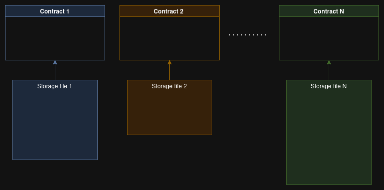
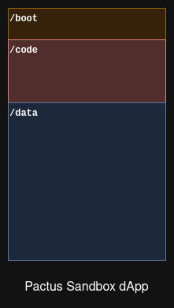

## Abstract

This proposal specifies how decentralized applications (called **Applications**, or **dApps**) are
stored and executed on Pactus.
Each Application owns a single renewable **storage file** that holds the execution code and application data.
Applications run in a sandboxed engine, allocate their data through an in-file allocator,
and pay a deterministic fee based on the number of bytes they read and write and the amount of allocated memory.
Applications execute as native binaries and therefore gain maximum performance.

## Motivation

Ethereum-friendly blockchains keep contract data in a global key/value database, where
each item is addressed by a key derived from the contract's address. That model is a flat,
schemaless slot-to-value map, with no structure or metadata,
and without a simple way to delete a contract's data as a unit.
Pactus instead dedicates _one file per Application_, containing both code and data, which can be
renewed or deleted as a unit (see [Storage file](#storage-file)).

## Specification

The key words "MUST", "MUST NOT", "SHOULD" and "MAY" are to be interpreted as described in RFC 2119.

### Terminology

- **Application (dApp)**: code plus data, owned by an account, stored in one storage file.
- **Storage file**: the on-chain file assigned to an Application. It has a fixed capacity and a
  limited lifetime.
- **Engine**: the runtime family used to execute an Application. This proposal defines WASM;
  other engines MAY be added later.
- **Executor**: the component that loads an Application's code and runs it.
- **Allocator**: the in-file structure that hands out regions of the data section to the Application.

### Storage file

Each Application is defined in an isolated file that contains both code and data.
Storage is purchased before deployment, based on the capacity the owner needs.
When a purchase is confirmed, an empty file with the purchased capacity is created and assigned
to the owning account.

The file is divided into three parts:

| Part  | Contents                             |
| ----- | ------------------------------------ |
| /boot | Fixed-size metadata to boot the dApp |
| /code | The bytecode to run                  |
| /data | Application Data part                |

The file MUST be parsed strictly: offsets and sizes MUST lie inside the file, MUST NOT overlap, and
the header MUST be fully validated before any code is executed.
A file that fails validation MUST NOT be executed.

#### Boot Loader

The `/boot` section is a fixed-size 128-byte, versioned, little-endian structure.
It includes at least the following fields:

| Field         | Size (Bytes) | Description                                |
| ------------- | ------------ | ------------------------------------------ |
| `version`     | 2            | File format version                        |
| `engine`      | 1            | Engine used to execute the code            |
| `flags`       | 1            | Bitwise flags                              |
| `stack_size`  | 1            | Number of stack slots for data allocation  |
| `reserved`    | 3            | Reserved for future use                    |
| `created_at`  | 4            | Block height at which the file was created |
| `expires_at`  | 4            | Block height after which the file expires  |
| `code_offset` | 4            | Offset of the execution code               |
| `data_offset` | 4            | Offset of the data section                 |
| `reserved`    | -            | Bytes reserved for future fields           |

The `engine` field defines the engine for executing the application code. Currently it supports
WASM as `1`.
Changing the layout of existing fields requires a new `version`, and nodes MUST reject versions
they do not understand.

#### Execution code

The `/code` section contains the compiled bytecode for the declared `engine`.
For the WASM engine this is a standard WASM module.
An executor MUST reject a module that does not validate, that imports anything other than the
whitelisted host functions, or that exceeds the configured limits (module size, memory pages,
table size, and stack depth).

#### Data

The data section holds the initial state of the Application and the space reserved for future use.
The owner MUST allocate enough space for future needs, but MAY extend the file by purchasing
additional capacity.
Extending the file increases `data_size` and reserves the new bytes at the end of the data section;
existing offsets MUST NOT change.

### Executor

To execute an Application, the executor compiles the code ahead of time to native machine code and
invokes the Application's entry point. The node MAY cache the binary, since the code does not
change, to avoid recompiling on every run.
Running native code is the point of this design: there is no
interpreter loop and no per-opcode instrumentation in the execution path.
For the WASM engine the entry point is an exported function named `execute`.
The executor MUST provide only the host functions that are part of the engine's whitelist, for
example reading and writing Application data.
The executor MUST NOT expose the host filesystem, the network, or any other ambient capability.

### Allocation

#### Non-persistent Memory Allocation

The engine allocates non-persistent memory that has a short life during the application execution.
This memory is managed by the engine and is capped to a maximum of 32 megabytes.
Any attempt to allocate memory beyond this capacity MUST be terminated by the host.

#### Persistent Memory Allocation

Each application has persistent memory that is stored in the `/data` sector.
It starts with a fixed stack array, defined in the `/boot` sector. Each item is 4 bytes and stores
the allocation offset of the persistent storage inside the file.
It allocates regions from the data section, and each region is bound to a value such as a map or a
slice. The Application can then read from or write within the region it owns.
The stack offsets define the exact position from which the data is read. They start at
`num_of_stack * 4` and MUST NOT exceed the `/data` size.

Out-of-bounds access MUST abort execution.

### Execution metering

The gas metering introduced by Ethereum has two main functions:

1. It determines exactly and deterministically how much resource an Application used, including
   computational and storage resources, so that its execution fee can be calculated.
2. It acts as a guard, often named _exhausted_, that stops an Application from running forever and
   keeps nodes from running malicious or malfunctioning code. Since these machines are
   Turing-complete, termination cannot be decided statically; the bound MUST be enforced at
   runtime.

To meter execution, every opcode must be monitored and assigned a gas cost.

Projects such as CosmWasm try to solve this by injecting gas metering into WASM.
The metering is applied to the module before compilation, at upload, and the injected checks then
run during execution. The problem with this approach is that the injected checks slow down every
execution, and that a gas cost must be defined for every WASM operator, not just a few high-level
operations as in Solidity.
The result is a large, brittle cost table and slower execution for every Application,
even the ones that would otherwise be cheap to run.
Another drawback is that this approach sacrifices simplicity.

Pactus does not apply the gas metering approach. It compiles the WASM code into a native binary
for the host machine and runs the application.

It separates the two functions above into two internal mechanisms:

1. **Fee.** The execution fee is calculated from the number of bytes the Application reads from and
   writes to its file, plus the number of allocated memory bytes.
   This metering is deterministic: given the same transaction and the same
   starting state, every node computes the same fee. Because the Application owns its allocator and
   operates only inside its own file, the computational cost of running code is **not** charged;
   running an Application is free of charge in terms of computation.
2. **Guard.** To stop an Application from exhausting resources, execution is bounded by a timeout
   rather than an opcode counter.

Keeping the fee and the guard separate is what makes the design simple: there is no gas table to
maintain, and the fee is a function of the bytes touched rather than a schedule of per-operator
costs that must evolve with the runtime.

Because the fee does not depend on the number of instructions, a deployed Application can run
arbitrarily complex logic at machine speed.

### Execution timeout

Pactus does not use an opcode gas limit.
Instead, each validator enforces a wall-clock timeout while running an Application.
The proposer's timeout SHOULD be lower than the network average timeout, so that a transaction
which is too slow on the proposer is not included, and a block whose execution exceeds the network
timeout on a majority of nodes is rejected.
This gives validators an incentive to exclude Applications that are too expensive to run, and it
prevents an exhausted Application from being committed to the chain.

Timeout values are node configuration, not consensus constants, and MAY be adjusted based on the
machine specification and user preferences.
Because the timeout depends on the machine and load of each node, it does not have the
determinism of byte metering. Pactus accepts this deliberately: native execution is the win point,
and a non-deterministic guard is the price of keeping the execution path free of per-opcode
instrumentation.

### Application lifecycle

1. **Purchase and creation.** An account purchases capacity. A file of that capacity is created,
   `created_at` is set to the current height, and `expires_at` is set to `created_at` plus the
   rental period.
2. **Deployment.** The owner writes the execution code into the file.
3. **Renewal.** Before `expires_at`, the owner renews the file by paying for another rental period.
   Renewal updates `expires_at`.
4. **Expiration.** Once `expires_at` passes, the file is marked read-only. It MUST NOT accept writes
   or execute state-changing entry points.
5. **Grace period.** The read-only file remains readable for a grace period.
6. **Deletion.** After the grace period, the file is deleted from nodes and its space is freed.
   Evidence of the file remains in blockchain history.

Deleting a file purges all data and code that belong to the Application.
The owner is warned at deployment that an Application which is not renewed will be deleted.

### Application address

An Application is owned by an account and is addressed by that account's address.
Each file is stored on every node under the same account address, and after each mutation the
file's Merklized hash is recalculated.

### Merklized hash

The storage file is split into fixed-size chunks of 1 MB.
Each chunk is hashed, and the chunk hashes are combined into a Merkle tree whose root becomes part
of the account info.

## Backwards Compatibility

This PIP adds a new kind of state (Application storage files) and requires new transaction
payloads.
It requires a protocol upgrade as described in PIP-51.
